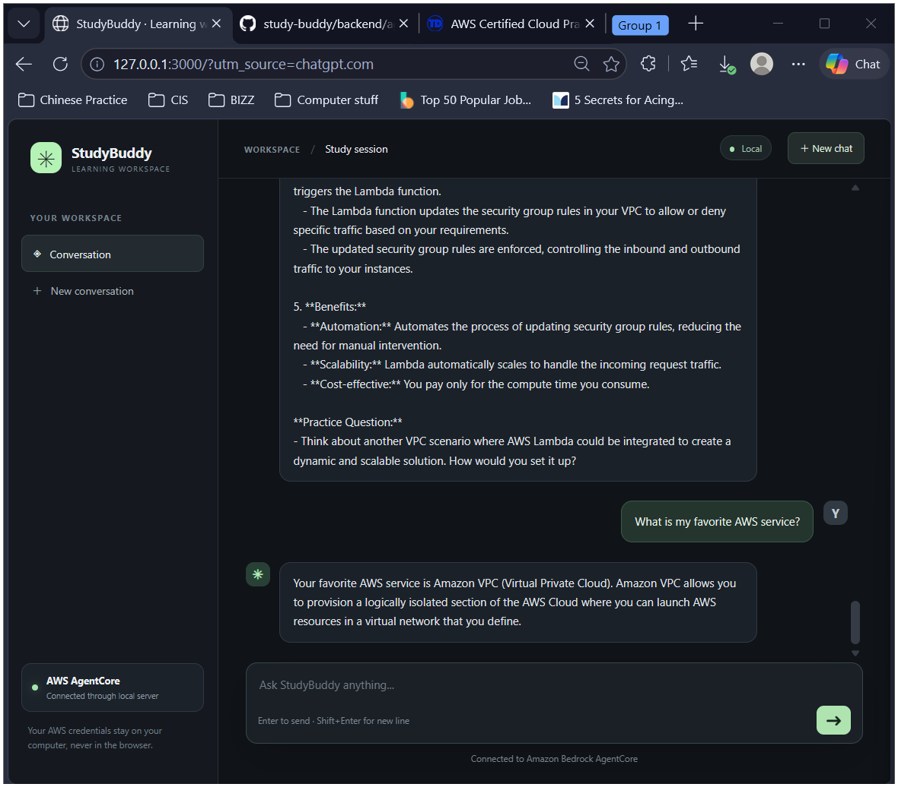
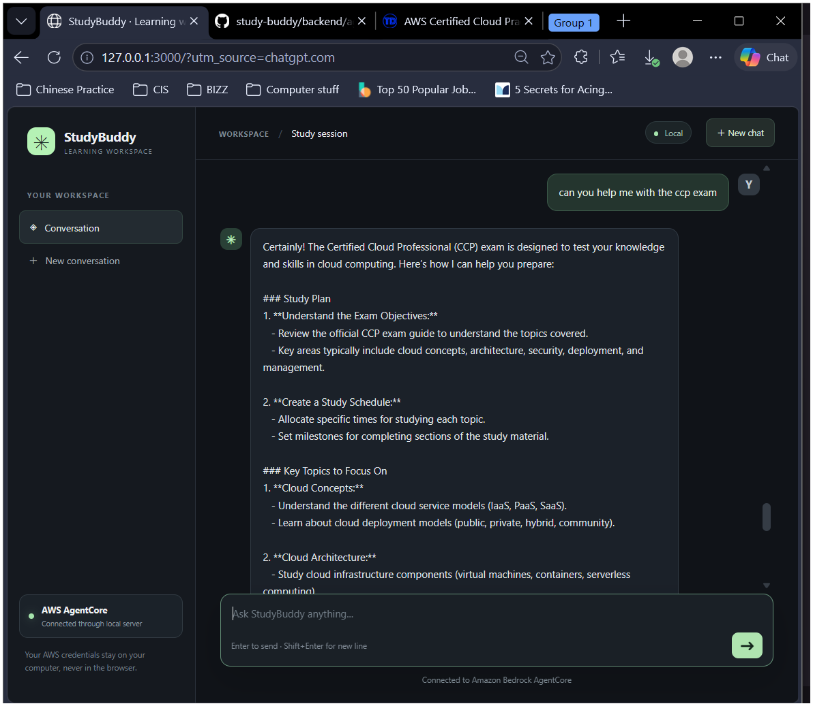
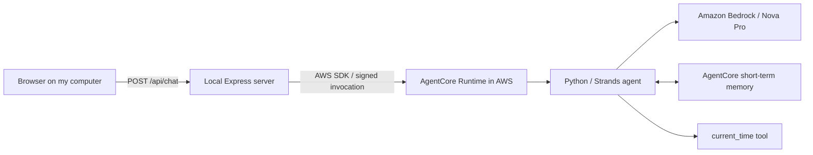

# StudyBuddy: AWS study assistant

I followed an AWS AgentCore workshop to build and test a study assistant, then connected it to a local browser chat interface. The useful part for me was following a request from the browser through a backend to an AWS-hosted Python agent, and troubleshooting the steps between them.

**Status: workshop prototype demonstrated; documentation and source snapshot preserved. No public chat service is offered.** The saved October 21, 2026 browser test shows the assistant recalling Amazon VPC from an earlier message. I chose to remove the cloud deployment after the workshop to reduce costs. Complete cloud deletion and zero remaining charges have not been independently verified; see [verification and limits](docs/verification.md).

## What it does

- Answers study questions using Amazon Nova Pro through Amazon Bedrock.
- Uses a tutor system prompt for explanations and practice questions.
- Uses AgentCore short-term conversation memory with a session ID.
- Registers a `current_time` tool. A time response was captured, but a tool-call trace was not saved.
- Accepts browser messages through a local Node.js/Express server, keeping AWS credentials out of browser code.

This is a **guided, AI-assisted learning project**, rather than an independently designed production system. [My contribution and help used](docs/case-study.md) are described separately from the workshop foundation.

## Screenshots



*The saved local browser conversation recalls Amazon VPC. This is evidence of the workshop demo, not a live service, an accuracy benchmark, or proof of isolation between different users.*



*The browser receives an AWS-generated response. Raw Markdown is visible. The model also expands CCP incorrectly in this capture; generated answers still need fact-checking against authoritative study materials.*

## How the pieces fit



The diagram shows the implemented HTTP request path. Responses return through Express. It does **not** claim Cognito login, a public API, or WebSocket streaming. Those appear in the workshop's larger reference project, not in this browser demo. See [architecture](docs/architecture.md).

## Tools used

Python, Strands Agents, Amazon Bedrock AgentCore SDK, Amazon Nova Pro, Node.js, Express, AWS SDK for JavaScript, AWS CLI, AWS SAM/CloudFormation, S3, PowerShell, WSL Ubuntu, and Kiro as an editor/terminal. These describe the workshop stack; they are not claims of independent proficiency in every tool.

## Read the project

| Document | What it covers |
| --- | --- |
| [Case study](docs/case-study.md) | Goal, contributions, decisions, results, and limits |
| [Architecture](docs/architecture.md) | Request flow, memory, deployment, and trust boundaries |
| [Workshop milestones](docs/milestones.md) | How the seven guide steps map to the work completed |
| [Setup](docs/setup.md) | Local checks and requirements for a future controlled rerun |
| [Troubleshooting](docs/troubleshooting.md) | Observed failures, resolutions, and unresolved checks |
| [Verification](docs/verification.md) | Saved evidence, review checks, and what is not verified |
| [Learning notes](docs/learning.md) | Plain-language explanations and interview practice |
| [Origin and source scope](docs/provenance.md) | Workshop credit, AI assistance, and excluded files |

## Source snapshot and local checks

`agent.py` and `frontend/` preserve the local implementation. `package-and-upload.sh` is the AI-assisted packaging companion used during the workshop; it is not a deployment command for a complete public application. `source-manifest.json` records unchanged source and screenshot hashes.

```powershell
cd frontend
npm ci --ignore-scripts
npm run check
```

These checks validate JavaScript syntax without calling AWS. They do not prove cloud deployment or model behavior. The [setup notes](docs/setup.md) explain configuration before any live test. A live test can incur AWS charges.

## Current limits

The UI is local-only, uses one workshop actor identity, and does not authenticate different users. Markdown is shown as plain text. New Chat changes the session ID in code, but independent-session isolation was not demonstrated in saved evidence. The current-time response lacks a tool execution trace. No automated evaluation, load test, uptime measurement, or production security assessment is claimed.

## Help used and origin

The starting point was **Build an AI Agent with AWS Bedrock AgentCore: Student Guide**, dated October 18, 2026, and Andres's workshop. The guide links to [andmoredev/study-buddy](https://github.com/andmoredev/study-buddy), a more complete reference implementation. Its features should not be attributed to this smaller project.

ChatGPT helped with code, explanations, troubleshooting, and milestone notes. Kiro was used as the editor and terminal; this project is not presented as an independent Kiro AI implementation. Codex reviewed the available chat, source, and screenshots, prepared this documentation and safe source snapshot, and added the portfolio case study. The original local project was preserved.
