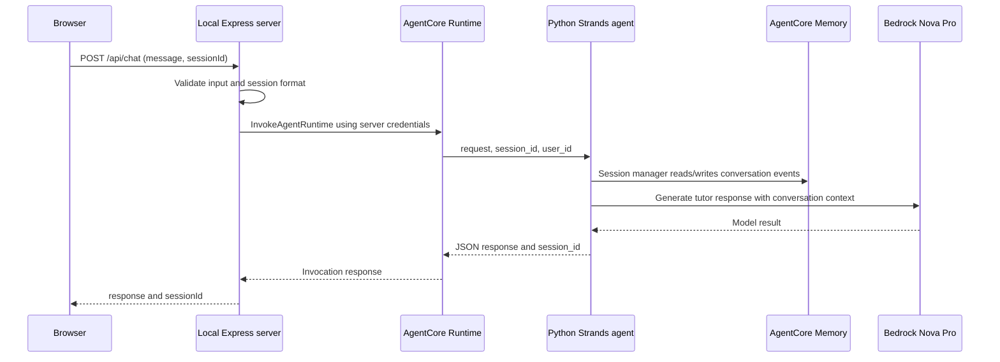
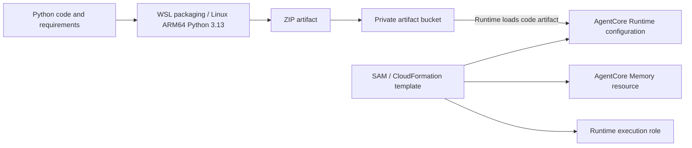

# Architecture

## Implemented browser request path

This is a simplified logical flow, not a network trace. The Strands memory session manager controls event access; passing a runtime session ID alone is not the entire memory implementation. A registered `current_time` tool may be selected by the agent. No saved trace proves selection in the time test.

## What each component does

| Component | Role in the saved source |
| --- | --- |
| Browser `frontend/public/app.js` | Sends a message, displays text, and stores a UUID in tab session storage. |
| Express `frontend/server.js` | Binds to `127.0.0.1:3000`, validates messages, and invokes AWS through the SDK. |
| AgentCore Runtime | Hosts the Python agent used in the cloud demonstration. |
| `agent.py` | Defines the request handler, tutor prompt, model, memory session manager, and tool registration. |
| Amazon Bedrock / Nova Pro | Provides generated responses using the configured US inference profile. |
| AgentCore Memory | Stores/retrieves conversation events for an actor and session. The supplied template configures a 30-day event expiry. |
| `current_time` | Tool registered in Strands for time questions; invocation tracing remains unverified. |

## Session behavior

The browser sends `sessionId`; Express passes it as both `runtimeSessionId` and payload `session_id`. The agent uses that payload value for `AgentCoreMemoryConfig`. Express sets `user_id` to `workshop-student`, so this is one workshop actor, not independent authenticated users.

New Chat creates another UUID in browser code. It does not delete earlier AWS memory, prove cross-session isolation, or establish multi-user privacy. A browser refresh retains the tab's session ID but does not reconstruct the visible transcript from storage.

## Deployment flow used in the workshop

S3 stores the artifact; it does not execute the chatbot. SAM/CloudFormation provisions resources. The runtime execution role and the identity running deployment are separate permissions concerns.

The local folder also contains API Gateway, Cognito, and Lambda/WebSocket reference scaffolding. The verified Express browser path does not use those components. This repository links to that broader reference instead of claiming its authentication or streaming works in this prototype.

## Trust and production boundaries

The AWS SDK signs requests from the server. Browser code contains no AWS credentials. Keeping credentials server-side is one boundary, not a complete production security design. The development record used a root identity; a controlled rerun requires non-root access. No rate limiting, authenticated user mapping, public hosting, guardrail evaluation, or completed least-privilege review is claimed.

Official references checked October 21, 2026:

- [AWS direct code deployment for Python](https://docs.aws.amazon.com/bedrock-agentcore/latest/devguide/runtime-get-started-code-deploy-python.html)
- [AWS AgentCore memory types](https://docs.aws.amazon.com/bedrock-agentcore/latest/devguide/memory-types.html)
